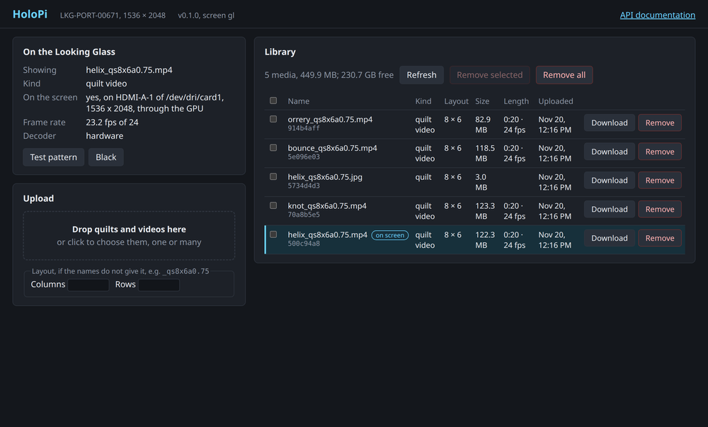
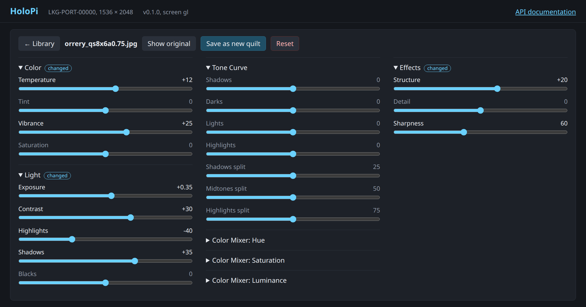

# HoloPi

[](https://github.com/kineticsystem/holo-pi/actions/workflows/ci.yml)

## Table of Contents <!-- omit in toc -->

- [Introduction](#introduction)
- [Prerequisites](#prerequisites)
- [Set Up the Raspberry Pi](#set-up-the-raspberry-pi)
  - [Install Raspberry Pi OS Lite](#install-raspberry-pi-os-lite)
  - [Install Docker and Git](#install-docker-and-git)
  - [Install HoloPi](#install-holopi)
  - [A Clean Screen at Boot](#a-clean-screen-at-boot)
- [Use HoloPi](#use-holopi)
  - [The Web Page](#the-web-page)
  - [Show a Quilt](#show-a-quilt)
  - [Grade a Quilt](#grade-a-quilt)
  - [The Library](#the-library)
  - [Play a Video](#play-a-video)
  - [Make a Quilt Video](#make-a-quilt-video)
  - [Check the Looking Glass with the Test Pattern](#check-the-looking-glass-with-the-test-pattern)
  - [The API](#the-api)
- [Manage the Server](#manage-the-server)
- [Other Ways to Run HoloPi](#other-ways-to-run-holopi)
  - [On a Desktop](#on-a-desktop)
  - [The Server Without Docker](#the-server-without-docker)
  - [The Command Line Without a Desktop](#the-command-line-without-a-desktop)
  - [Save a Hologram and See the Calibration](#save-a-hologram-and-see-the-calibration)
  - [Use It as a Library](#use-it-as-a-library)
- [Tests](#tests)
- [Troubleshooting](#troubleshooting)
- [Licences](#licences)

## Introduction

HoloPi turns a Raspberry Pi into a network display for the **Looking Glass Portrait**, Looking Glass Factory's 7.9" 3D display. Plug the Portrait into the Pi, and any computer on the network shows a hologram on it with one HTTP request, or from the Pi's web page:

```bash
curl -F file=@helix_qs8x6a0.75.jpg -F play=true http://holo.local:8095/api/media
```

The hologram is a quilt, the format of Looking Glass's still holograms: one image holding a grid of views of a scene, each seen from a slightly different direction, 48 views in 8 columns and 6 rows for the Portrait. It works with any quilt, from any software that makes them: a render, a photo session, a script. On the Pi, HoloPi:

- reads the Portrait's calibration from the Portrait itself, which carries it on its own USB drive;
- interleaves the quilt into the image the Portrait's screen must show, so that each eye sees the right view through its lenses;
- shows that image on the Portrait, pixel for pixel, straight through the Pi's HDMI, with no desktop and no window;
- keeps every quilt in a library on its disk, to show again by its id or its name, at once, and shows the last one again after the Pi restarts, or a test quilt until the first one comes.

It also plays videos of quilts in a loop, interleaving each frame on the Pi's GPU as it is shown, and videos already interleaved for the Portrait, as the ones the Portrait keeps on its own drive, see [Play a Video](#play-a-video). Its web page shows it all, and uploads, see [The Web Page](#the-web-page), and grades quilts while the Portrait shows them, see [Grade a Quilt](#grade-a-quilt).

<!-- The source is docs/diagrams/overview.mmd: change it, then run bin/render-diagrams.sh. -->
<p align="center"></p>

The Pi needs only Docker: HoloPi runs in a container that starts with the Pi. On a Pi 5, a quilt is on the Portrait about 0.3 seconds after its upload, and the Portrait shows a hologram about a minute and a half after the Pi is switched on.

HoloPi also runs without a Pi, on an Ubuntu desktop with the Portrait as a second monitor, see [Other Ways to Run HoloPi](#other-ways-to-run-holopi).

> [!NOTE]
> HoloPi is made and tested with the Looking Glass Portrait and a Raspberry Pi 5 only. Looking Glass's other displays use the same kind of calibration and may work, but none has been tried, see [Other Looking Glass Models](#troubleshooting). A Raspberry Pi 4 runs the same system, and should work too.

## Prerequisites

- **A Raspberry Pi 5,** with its power supply and a microSD card of 8 GB or more.
- **A Looking Glass Portrait,** on the Pi's HDMI, with a micro-HDMI to HDMI cable, and on one of the Pi's USB ports, with a cable that carries data, not only power: through it, the Pi reads the Portrait's calibration from its drive.
- **A network,** Ethernet or Wi-Fi, that the Pi and the computers that send quilts share.
- **A computer to set up the Pi,** with [Raspberry Pi Imager](https://www.raspberrypi.com/software/) and an SD card reader, and an SSH client.

> [!WARNING]
> The server has no authentication: anyone who reaches its port can change what the Looking Glass shows. Keep it on a network you trust.

## Set Up the Raspberry Pi

### Install Raspberry Pi OS Lite

HoloPi draws on the Portrait itself, which only works where no desktop holds the screen: install Raspberry Pi OS **Lite**, without a desktop. In Raspberry Pi Imager, on the computer:

1. **Device:** Raspberry Pi 5.
2. **Operating system:** Raspberry Pi OS (other), then Raspberry Pi OS Lite (64-bit).
3. **Storage:** the microSD card.
4. **Customisation,** when Imager offers to edit the settings:
   - the hostname, e.g. `holo`, which the examples here use: the Pi is then `holo.local` on the network;
   - a user and a password;
   - the Wi-Fi network and its country, unless the Pi is on Ethernet;
   - SSH on, with public-key authentication, and our public key, e.g. the contents of `~/.ssh/id_ed25519.pub`.

Write the card, put it in the Pi, and switch the Pi on. After a minute or two, log in from the computer:

```bash
ssh <user>@holo.local
```

Every command below runs on the Pi, in that SSH session.

### Install Docker and Git

Install git and Docker, and add our user to the group `docker`, to run Docker without `sudo`:

```bash
sudo apt update && sudo apt full-upgrade -y
sudo apt install -y git
curl -fsSL https://get.docker.com | sudo sh
sudo usermod -aG docker $USER
sudo reboot
```

The group applies at the next login. Log in again, and check that Docker works without `sudo`:

```bash
docker run --rm hello-world
```

### Install HoloPi

Check out the repo, build the image and start the server:

```bash
git clone https://github.com/kineticsystem/holo-pi.git
cd holo-pi
./docker/dock.sh build
./docker/dock.sh start
```

The build takes a few minutes on a Pi: the image is Debian's packages of Python, numpy, Pillow, FastAPI, uvicorn, PyAV, libdrm and Mesa, with Raspberry Pi's FFmpeg on a Pi, and the web page, which a first stage builds with Node.js; nothing else is compiled. Then the Portrait shows the test quilt of numbered views, and the server answers on port 8095:

```bash
curl http://holo.local:8095/api/status
```

The server starts with the Pi from now on, until `./docker/dock.sh stop`. Its web page is on `http://holo.local:8095`, and its API is documented live, with a page to try each request, on `http://holo.local:8095/api/docs`.

### A Clean Screen at Boot

Until the server draws, the Portrait shows the Pi's console: the rainbow splash, the kernel's messages and the login prompt, for the minute and a half the Pi and Docker take to start. Three changes leave it black instead, until the hologram appears.

In `/boot/firmware/cmdline.txt`, one line, replace `console=tty1` with `console=tty3`, which moves the kernel's messages off the screen, and add at the end of the line:

```
quiet loglevel=3 logo.nologo vt.global_cursor_default=0 consoleblank=0
```

`vt.global_cursor_default=0` hides the blinking cursor, and `consoleblank=0` keeps the console from blanking the screen.

At the end of `/boot/firmware/config.txt`, for no rainbow splash at power-on:

```
disable_splash=1
```

And no login prompt on the screen:

```bash
sudo systemctl disable getty@tty1
```

Reboot. The login prompt is only of use with a keyboard and a user with a password: SSH is not affected. `sudo systemctl enable getty@tty1` brings it back.

## Use HoloPi

### The Web Page

The Pi serves a web page, on the same port as its API: http://holo.local:8095, or the Pi's address, e.g. http://192.168.100.41:8095. It shows what the Looking Glass shows, with a video's frame rate and decoder, and the media kept on the Pi: a click on a row shows it, the arrow keys show the one above or below, a row dragged by its grip, ⠿, or moved with Alt and the arrow keys, puts the library in another order, and each can be renamed, downloaded or removed, one, those ticked or all at once; quilts and videos dropped on it, one or many, are uploaded, and the first is shown at once. Its header links the API's documentation.

<p align="center"></p>

It is for trying things at once, without knowing the API. Everything it does goes through the API, which a program uses, as below.

### Show a Quilt

From any computer on the network, with `curl`, e.g. the repo's sample quilt, [`quilts/helix_qs8x6a0.75.jpg`](quilts/helix_qs8x6a0.75.jpg), a double helix of shiny beads above a checkered floor, rendered from 48 angles by [`quilts/make_assets.py`](quilts/make_assets.py):

```bash
curl -F file=@quilts/helix_qs8x6a0.75.jpg -F play=true http://holo.local:8095/api/media
```

The Pi keeps it in its library, shows it, and answers with what it kept, `201 Created`:

```json
{"id": "b44ef8ba", "name": "helix_qs8x6a0.75.jpg", "kind": "quilt", "size": 2979997,
 "uploaded": "2026-11-17T13:20:01+00:00", "width": 3360, "height": 3360, "columns": 8, "rows": 6,
 "reverse": false, "fps": null, "frames": null, "duration": null, "codec": null, "warning": null, "grade": null,
 "shown": true}
```

Through the lenses, an orange sphere stands at the screen's depth, a red one in front of it and a green one behind, and they turn as you move your head sideways. The sample is a quilt to compare yours with: it looks right on a Portrait.

The layout comes from the file's name, as Looking Glass's own tools read it: `_qs8x6a0.75` is 8 columns, 6 rows, views of aspect 0.75. For a quilt whose name does not say, give it with the fields `columns` and `rows`, and add `reverse` if the depth looks inside out, near parts behind far ones:

```bash
curl -F file=@my-quilt.png -F columns=8 -F rows=6 -F reverse=true -F play=true http://holo.local:8095/api/media
```

From Python, with `requests`:

```python
import requests

with open("helix_qs8x6a0.75.jpg", "rb") as quilt:
    response = requests.post("http://holo.local:8095/api/media", files={"file": quilt}, data={"play": "true"},
                             timeout=60)
response.raise_for_status()
print(response.json()["id"])
```

### Grade a Quilt

Grading changes a quilt's light and colours while the Portrait shows it. Show a quilt of the library, then click **Grade…**, below what the Looking Glass shows. The grading page opens, and the Portrait follows each slider as it moves:

<p align="center"></p>

The tools are those of StepIt Grader, our desktop program that grades photographs:

| Section | Tools |
|---|---|
| Color | Temperature, tint, vibrance, saturation. |
| Light | Exposure, in stops, contrast, highlights, shadows, blacks. |
| Tone Curve | Shadows, darks, lights and highlights, and the tones where these zones meet. |
| Color Mixer | The hue, saturation and luminance of eight colours, from red to magenta, folded at first. |
| Effects | Structure, detail, sharpness. |

A double click on a slider puts its default back. The buttons at the top:

- **Show original** shows the quilt without its grade, to compare; **Show graded**, or moving a slider, brings the grade back.
- **Save as new quilt** adds the graded quilt to the library, as a file of its own, a PNG named e.g. `helix-graded_qs8x6a0.75.png`, to download and show on any Looking Glass. The original and its grade stay. It takes about a second on a Pi 5.
- **Reset** puts every tool back to its default.
- **← Library** goes back.

A graded quilt has a **graded** badge in the library, or **grade off** while its original is shown, and the card of what the Looking Glass shows says the same. A quilt saved as a new one has no badge: its grade is in its pixels.

There is nothing else to save: the server keeps the grade with the quilt as we work, also across a restart, and never changes the quilt's file, so **Download** gives the original. An upload of the same name replaces the quilt and drops its grade.

The Pi's GPU works the grade out as it draws. On a Pi 5, measured with a Portrait over the network, a step of a slider takes about 17 ms for light and colour, and about 33 for highlights, shadows, structure, detail and sharpness, which take about half a second the first time one of them is used on a quilt. Only quilts can be graded, not videos, and only through the GPU, `--screen gl`, as the container shows them; otherwise **Grade…** is disabled and says why.

A script grades with [the API](docs/API.md#the-grades):

```bash
curl -X PUT -H "Content-Type: application/json" -d '{"exposure": 0.5, "saturation": 20}' http://holo.local:8095/api/media/<id>/grade
```

### The Library

Every upload stays on the Pi, in its library, until it is removed: without `play`, an upload is only kept, and what the Looking Glass shows does not change. Show one later by its id or its name, at once, with nothing sent but its name:

```bash
curl -X PUT -H "Content-Type: application/json" -d '{"media_name": "helix_qs8x6a0.75.jpg"}' http://holo.local:8095/api/display
```

On a Pi 5, a quilt is on the Looking Glass about 0.8 seconds later, a video about 0.2 seconds later, where uploading a 120 MB video takes about 2.5 seconds over gigabit Ethernet. An upload of a name the library has replaces it, and keeps its id and its place in the list.

**Rename**, on a medium's row of the web page, changes its name in place: Enter takes it, Escape leaves it. Its file, its grade, its place and what the Looking Glass shows stay. A name another medium has is refused, and the extension stays. The medium keeps its layout even if the new name no longer says it, e.g. without `_qs8x6a0.75`, but another program that reads a downloaded copy would not know it.

| Request | What it does |
|---|---|
| `GET /api/media` | Lists the library, with the space it takes and the space left. |
| `POST /api/media` | Uploads a quilt or a video into it; with `play=true`, shows it too. |
| `PUT /api/media/order` | Puts the library in another order, `{"ids": [...]}`, every id once. |
| `GET /api/media/{id}` | Says what a medium is. |
| `GET /api/media/{id}/content` | Downloads its file, as uploaded. |
| `PUT /api/media/{id}/name` | Renames it, `{"name": ...}`. |
| `DELETE /api/media/{id}` | Removes it, its file too. |
| `DELETE /api/media` | Empties the library. |

### Play a Video

A quilt video is a video whose every frame is a quilt. HoloPi plays it in a loop, and its GPU interleaves each frame as it is shown, so that it starts at once and plays on any Portrait. The repo's [`quilts/`](quilts/README.md) has some to try, e.g. a double helix:

```bash
curl -F file=@quilts/helix_qs8x6a0.75.mp4 -F play=true http://holo.local:8095/api/media
```

As for a quilt, the layout comes from the file's name, e.g. `_qs8x6a0.75`, or from the fields `columns` and `rows`, with `reverse` if the depth looks inside out. `GET /api/display` says how it plays: `frame_rate`, the frames it shows a second, and `decoder`, `hardware` when the Pi 5's HEVC decoder decodes it, `software` when its processor does. A video not in H.265 comes with a `warning`, which says how to encode it again.

A video without a layout is a hologram video: every frame is already interleaved for one Looking Glass, the image its screen shows. The Portrait keeps such videos on its own drive, next to its calibration, e.g. `Anna.jpg__lkgrec.mp4`, HEVC at 3072 x 2048 and 12 frames per second, and plays them without a computer. HoloPi shows each frame as it is, so a hologram video plays right only on the Looking Glass whose calibration made it. Its frames are the screen's size, 1536 x 2048 for a Portrait, or twice as wide, 3072 x 2048, as the Portrait's own; any other size is refused with `400`.

### Make a Quilt Video

A quilt video plays best on a Pi 5 as HEVC, which its hardware decoder decodes with little of the processor, at 24 frames per second, with a Portrait's usual quilt of 8 x 6 views, 3360 x 3360. From numbered quilts, `frame_0001.png`, `frame_0002.png`, and so on, with FFmpeg:

```bash
ffmpeg -framerate 24 -i frame_%04d.png -c:v libx265 -crf 20 -pix_fmt yuv420p -tag:v hvc1 my_animation_qs8x6a0.75.mp4
```

On a Pi 5, such a video plays at up to about 25 frames per second: the GPU interleaves a frame in about 27 ms. Its hardware decoder decodes even a detailed one, the helix at 49 Mbit/s, at about 43 frames per second, with about one of the processor's four cores to copy the frames out. It decodes HEVC only: an H.264 video is decoded by the processor, which keeps up with a Portrait's quilt only when its bitrate is low. A quilt is at most 4096 x 4096, the largest picture the Pi 5's GPU takes.

### Check the Looking Glass with the Test Pattern

```bash
curl -X PUT -H "Content-Type: application/json" -d '{"test_pattern": true}' http://holo.local:8095/api/display
```

It shows a test quilt whose 48 views each show their number, 1 to 48, large, on a colour of their own; the Pi also shows it at its first start. Through the lenses, one number fills the screen, and it changes in order as you move your head sideways. Some ghosting of the next numbers is normal: neighbouring views are this different only in the test. A mix of numbers across the screen, or a white blur, means that the calibration is wrong, see [Troubleshooting](#troubleshooting).

### The API

The API is on `/api`, documented by the server itself with Swagger UI on [`/api/docs`](http://holo.local:8095/api/docs), with a form to try each request, and as OpenAPI on `/api/openapi.json`. [docs/API.md](docs/API.md) describes every request and answer. Besides the library's:

| Request | What it does |
|---|---|
| `GET /api/media/{id}/grade` | A quilt's grade, see [Grade a Quilt](#grade-a-quilt). |
| `PUT /api/media/{id}/grade` | Grades a quilt, e.g. `{"exposure": 0.5, "saturation": 20}`. |
| `DELETE /api/media/{id}/grade` | Removes its grade. |
| `POST /api/media/{id}/graded-copies` | Saves the quilt with its grade, as a new quilt. |
| `GET /api/grade-parameters` | What a grade is made of, with the ranges. |
| `GET /api/display` | What the Looking Glass shows, whether it is on the screen, where or why not, and how a video plays. |
| `PUT /api/display` | Shows a medium of the library, `{"media_id": ...}` or `{"media_name": ...}`, or the test pattern, `{"test_pattern": true}`. |
| `DELETE /api/display` | Shows black; what was shown stays in the library. |
| `GET /api/status` | The server's version, its screen, the Looking Glass, and what it shows. |
| `GET /api/calibration` | The Looking Glass's calibration. |

What the Looking Glass shows stays, also across a restart of the Pi. With nothing kept, at the first start or after `DELETE /api/display`, a restart shows the default quilt, the test pattern.

If something cannot be shown, because the Looking Glass is unplugged or switched off, the server keeps it, answers `503` with the reason, and tries again every 5 seconds: it shows as soon as the Looking Glass is back, with nothing to send again. Every error answers `{"error": "<what went wrong, and what to check>"}`.

## Manage the Server

`./docker/dock.sh`, in the checkout on the Pi, manages the container, `holo-pi`:

| Command | What it does |
|---|---|
| `build` | Builds the image, `holo-pi:latest`, with the web page. |
| `start` | Starts the server in the background. It then starts with the Pi. |
| `logs` | Follows the server's output. |
| `status` | Shows the state of the container. |
| `shell` | Opens a terminal into the container. |
| `stop` | Stops the server, until the next `start`. |
| `clean` | Removes the container and the image; the volume of the library, `holo-pi_state`, stays. |

The image holds no Python code: the container runs the checkout, mounted read-only, so updating it is a pull and a restart. The web page is built into the image, so a pull that changes `web/` or `docker/` needs a `build` too:

```bash
git pull
./docker/dock.sh build
./docker/dock.sh stop && ./docker/dock.sh start
```

Two environment variables of `start` change the server:

| Variable | Default | What it is |
|---|---|---|
| `HOLO_PI_PORT` | `8095` | The port. |
| `HOLO_PI_DEFAULT_QUILT` | `numbers` | What to show when nothing is kept: `numbers`, the test pattern, or a quilt of the repo by its path, e.g. `quilts/helix_qs8x6a0.75.jpg`. |

The container is privileged and runs as root, which setting the screen's mode and mounting the Portrait's drive need. It mounts the drive itself, read-only, inside the container only. It mounts the Pi's `/dev`, so that the Portrait can be unplugged and plugged in again, and listens on the Pi's network. Its volume, `holo-pi_state`, keeps the library, what was shown last and the tables of the interleaving.

The server draws through the GPU, `--screen gl`. On a Pi, the image takes FFmpeg and Mesa from Raspberry Pi's own repository rather than Debian's: their FFmpeg reaches the Pi 5's hardware HEVC decoder. The image is built on the Pi, by `./docker/dock.sh build`, so a `git pull` that changes [`docker/Dockerfile`](docker/Dockerfile) needs a `build` before the restart.

## Other Ways to Run HoloPi

The Pi is the easiest way to keep a Portrait showing holograms. The same code also runs on a desktop, with the Portrait as a second monitor, and from the command line.

### On a Desktop

On Ubuntu 24.04 or Raspberry Pi OS with a desktop, GNOME on X11 or on Wayland, or Raspberry Pi OS's own on Wayland, HoloPi shows the hologram in a full-screen window on the Portrait. Other Linux desktops should work.

- Install Python's numpy and Pillow, and GTK 3's Python bindings:

  ```bash
  sudo apt install python3-numpy python3-pil python3-gi gir1.2-gtk-3.0
  ```

- Plug the Portrait into HDMI and USB. The desktop mounts its drive, e.g. on `/media/<user>/LKG-P00671`.
- In the display settings, make the Portrait part of the desktop ("Join Displays"), in its own orientation. HoloPi draws at 100% whatever the desktop's scaling, so a whole factor, e.g. 200% on a 4K desktop, works too; a fractional one, e.g. 150%, does not under X11, where GNOME scales the whole screen image.

Then, from a checkout, with no installation:

```bash
git clone https://github.com/kineticsystem/holo-pi.git
cd holo-pi
./holo-pi show quilts/helix_qs8x6a0.75.jpg
```

The hologram fills the Portrait until you press Escape or `q` on its window, or stop the command. The command says `Showing on the monitor at ...` once the window covers the Portrait, and ends without an error on Ctrl+C or `SIGTERM`. `--columns`, `--rows` and `--reverse` work as the fields of an upload, and `./holo-pi numbers` shows the test quilt.

> [!IMPORTANT]
> Close Looking Glass Bridge if it runs: it would draw over HoloPi's window.

To have `holo-pi` on the `PATH`, install it with pipx. `--system-site-packages` lets it use the system's numpy, Pillow and GTK bindings:

```bash
sudo apt install pipx
pipx install --system-site-packages git+https://github.com/kineticsystem/holo-pi.git
```

### The Server Without Docker

The server also runs outside Docker, e.g. on a desktop, where it shows in a full-screen window, or for development:

```bash
./holo-pi serve
```

It needs FastAPI, uvicorn, python-multipart, for the videos PyAV, and for `--screen gl` Mesa's EGL and OpenGL ES: `sudo apt install python3-fastapi python3-uvicorn python3-multipart python3-av libegl1 libgles2 libgbm1` on Ubuntu 24.04, or `python3-python-multipart` instead of `python3-multipart` on Raspberry Pi OS Trixie and Debian 13, whose `python3-multipart` is another library. Without PyAV, the quilts work and an upload of a video answers `501`. Or pipx's extra `server` installs them:

```bash
pipx install --system-site-packages "holo-pi[server] @ git+https://github.com/kineticsystem/holo-pi.git"
```

The options:

| Option | Default | What it is |
|---|---|---|
| `--host` | `0.0.0.0` | The address to listen on: every one, so that other computers reach it. `127.0.0.1` for this computer only. |
| `--port` | `8095` | The port. |
| `--screen` | `auto` | `desktop`, a full-screen window; `drm`, straight on the screen, drawn by the processor; `gl`, straight on the screen, drawn by the GPU, which interleaves the quilts and quilt videos itself, as the container does; `auto`, `drm` if nothing drives the screen, the desktop otherwise. |
| `--calibration` | the Looking Glass's drive | A copy of `visual.json`. |
| `--state` | `~/.local/state/holo-pi` | Where the library is kept, and what was shown last, to show it again after a restart. |
| `--default-quilt` | none | What to show when nothing is kept, e.g. at the first start or after `DELETE /api/display`: `numbers`, the test quilt, or a quilt file whose name gives its layout, e.g. `quilts/helix_qs8x6a0.75.jpg`. It is shown, not kept: an upload replaces it. |
| `--mount-drive` | off | Mounts the Looking Glass's drive, read-only, when nothing has, e.g. without a desktop. Needs root. |
| `--web` | `$HOLO_PI_WEB`, or `web/dist` | The web page's built files. Without them, `/` leads to the API's documentation. |

The web page is built from [`web/`](web/README.md), with Node.js 24 and pnpm:

```bash
cd web
pnpm install
pnpm build
```

While changing it, `pnpm dev` serves it on http://localhost:5177, reloaded at each change, with the API of the Pi, or of another server, e.g. `HOLO_PI_URL=http://localhost:8095 pnpm dev`.

### The Command Line Without a Desktop

On a computer with no desktop, `show` and `numbers` draw straight on the screen, as the server does, through DRM/KMS: they set the Looking Glass's own mode, 1536 x 2048 for a Portrait, and give the display controller the hologram, pixel for pixel. They do so by themselves when a graphics card has a connected screen that no other program drives, whatever `DISPLAY` says, e.g. over `ssh -X`; `--screen drm` asks for it:

```bash
./holo-pi show quilts/helix_qs8x6a0.75.jpg --screen drm
```

The command says `Showing on HDMI-A-1 of /dev/dri/card1, 1536 x 2048`, and the hologram stays until Ctrl+C, when the console comes back. Our user must be in the group `video`, which owns `/dev/dri/card*`: Raspberry Pi OS puts the first user in it.

Without a desktop, nothing mounts the Looking Glass's drive. Mount it once by its label, read-only, where HoloPi looks for it:

```bash
ls /dev/disk/by-label/
sudo mkdir -p /media/$USER/LKG-P00671
sudo mount -o ro /dev/disk/by-label/LKG-P00671 /media/$USER/LKG-P00671
```

Or copy its `LKG_calibration/visual.json` once, and give it with `--calibration visual.json`.

> [!IMPORTANT]
> DRM/KMS works only where no desktop drives the screens: a desktop holds them, and the command then says `Permission denied: another program drives the screens`. On a desktop, use the default, `--screen desktop`.

### Save a Hologram and See the Calibration

```bash
./holo-pi render quilts/helix_qs8x6a0.75.jpg -o hologram.png
```

It saves the image the Looking Glass would show, of the screen's size, e.g. 1536 x 2048, without showing it: it needs no screen. It still needs the calibration: the Looking Glass's drive, or `--calibration visual.json`, a copy of it.

```bash
./holo-pi calibration
```

It prints where it found the calibration, and the values it derives from it. Every command takes `--calibration <file>` to use a copy of `visual.json` instead of the drive's, e.g. on a computer the Looking Glass is not plugged into. `./holo-pi numbers --quilt-output numbers_qs8x6a0.75.png` saves the test quilt instead of showing it.

### Use It as a Library

```python
import numpy as np
from PIL import Image

from holo_pi import Interleaver, Layout, find_calibration

calibration = find_calibration()
quilt = np.asarray(Image.open("quilts/helix_qs8x6a0.75.jpg").convert("RGB"))
interleaver = Interleaver(calibration, Layout(8, 6), quilt.shape[1], quilt.shape[0])
hologram = interleaver(quilt)  # An RGB array of the screen's size.
```

An `Interleaver` works out once which sub-pixel of the quilt each sub-pixel of the screen takes, about a third of a second on a PC, and keeps the table in `~/.cache/holo-pi`. Every quilt of the same layout and size then takes a lookup, about 15 ms on a PC. `holo_pi.screen.open_screen()` opens the screen to show it on, see [The Screens](docs/ARCHITECTURE.md#the-screens).

## Tests

```bash
python3 -m unittest discover tests
```

The tests need no display: they check the calibration, the layouts, the interleaving against views checked through a Portrait's lenses, the test quilt, the DRM screen's helpers, the command line and, with FastAPI, httpx and python-multipart installed, the API, the library and the display with a fake screen. With PyAV, they also play small lossless videos on a fake screen, frame by frame, on time and in a loop. With EGL and OpenGL ES 3, e.g. Mesa's or NVIDIA's driver, they check the GPU's interleaving against the processor's, off screen. Without these packages, their tests are skipped. How HoloPi is built is in [docs/ARCHITECTURE.md](docs/ARCHITECTURE.md).

The web page has its own, with Vitest:

```bash
cd web
pnpm test
```

GitHub runs both on every push and pull request, [`.github/workflows/ci.yml`](.github/workflows/ci.yml): the Python tests in Debian 13 with Debian's packages, the GPU's tests on Mesa's software renderer, the web page's type check, tests and build, and the build of the image.

The diagrams of the documents are SVG images rendered from their Mermaid sources, `docs/diagrams/*.mmd`. After changing one, run `bin/render-diagrams.sh`, which needs Node.js and Google Chrome or Chromium, and commit both files. `bin/check-diagrams.sh` fails when an image is older than its source.

## Troubleshooting

**The Portrait stays black, or shows the console, after the Pi is switched on.** The Pi and Docker take about a minute and a half to start the server. Then `curl http://holo.local:8095/api/status` says what the server sees, and `./docker/dock.sh logs` on the Pi what it did.

**The server answers `503`, and the quilt is kept.** It cannot show yet: the message says why, e.g. `no Looking Glass found` or `no screen of 1536 x 2048`. It tries again every 5 seconds, and `GET /status` says when it is shown.

**`no Looking Glass found`.** The Portrait's drive is not there. Check that its USB cable is plugged into the Pi and carries data: `lsusb` lists `Looking Glass Portrait` once it does.

**`no screen of 1536 x 2048`.** No connected screen of the Looking Glass's size: it is off, or not on HDMI. The message lists the screens it found, with their sizes.

**`Permission denied: another program drives the screens`.** A desktop holds the screens, so DRM/KMS cannot set their mode: the Pi runs Raspberry Pi OS with a desktop rather than Lite, or, on a computer with a desktop, use `--screen desktop`. Without a desktop, outside Docker, our user is not in the group `video`: `sudo usermod -aG video $USER`, and log in again.

**The Pi does not join the Wi-Fi, and its log says `CTRL-EVENT-ASSOC-REJECT ... status_code=16`.** The router does not answer the Pi at all, before the password is checked. A router whose 2.4 GHz network uses the encryption mode **TKIP&AES** rejects the Pi 5's Wi-Fi this way: set it to **AES** only. The log is in `sudo journalctl -u wpa_supplicant`.

**`no monitor of 1536 x 2048`, on a desktop.** The Looking Glass is not part of the desktop at its own resolution: it is off, not on HDMI, mirrored instead of joined, or scaled by a fractional factor. In the display settings, join it to the desktop, at 100% or a whole factor such as 200%.

**A grid of small images through the lenses.** The quilt is shown flat, as by a program that does not interleave it, e.g. Looking Glass Bridge in its window. Close the other program, and show the quilt with HoloPi.

**A mix of numbers with the test quilt.** The hologram is not exactly on the Looking Glass, or the calibration is another display's. Check `GET /api/calibration`, or `holo-pi calibration`, against the display's drive, and, on a desktop, that the scaling is a whole factor, e.g. 100% or 200%.

**The container's log says `Form data requires "python-multipart"`.** The image has Debian's `python3-multipart`, another library: build it again from this repo's [`docker/Dockerfile`](docker/Dockerfile), which installs `python3-python-multipart`.

**A video plays in slow motion, and `GET /api/display` gives a `frame_rate` below its `fps`.** The processor cannot decode it fast enough: `decoder` says `software`. On a Pi 5, encode it in HEVC, which its hardware decoder decodes, rather than H.264; if `decoder` still says `software` for HEVC, the image was built before the hardware decoder came in: `./docker/dock.sh build`, then `stop` and `start`.

**The image build stops with `SHA1 is not considered secure` for `archive.raspberrypi.com`.** apt was given the key from Raspberry Pi's web site, whose signatures Debian 13 refuses. The Dockerfile uses Raspberry Pi OS's copy instead, [`docker/raspberrypi-archive-keyring.pgp`](docker/raspberrypi-archive-keyring.pgp): build from this repo's Dockerfile.

**Other Looking Glass models.** They are untested. HoloPi uses the values that the Portrait's calibration holds, as Looking Glass's WebXR library uses them, and reads the screen's size from the calibration, so another model may work as it is. A model whose `visual.json` has `subpixelCells`, e.g. one of the newer ones, lays out its sub-pixels differently, which HoloPi ignores, and will not. The test quilt shows which: one number at a time through the lenses, or a mix. It is a Portrait's, 8 x 6 views of aspect 0.75; on another model, its views are stretched, but the numbers still show.

## Licences

HoloPi is released under the MIT licence, see [`LICENSE`](LICENSE).

The interleaving follows the formulas of Looking Glass's lenticular shader as their [WebXR library](https://github.com/Looking-Glass/looking-glass-webxr) publishes them, under the Apache 2.0 licence. HoloPi contains none of their code, and is not made or endorsed by Looking Glass Factory. Looking Glass is their trademark.

| Software | Licence | Role |
|---|---|---|
| [numpy](https://numpy.org/) | BSD 3-Clause | The interleaving. |
| [Pillow](https://python-pillow.org/) | HPND, BSD-like | Reads and writes the images. |
| [libdrm](https://gitlab.freedesktop.org/mesa/drm) | MIT | The screen, without a desktop. |
| [FastAPI](https://fastapi.tiangolo.com/), [uvicorn](https://www.uvicorn.org/) and [python-multipart](https://github.com/Kludex/python-multipart) | MIT, BSD 3-Clause, Apache 2.0 | The server. |
| [PyGObject](https://pygobject.gnome.org/) and [GTK](https://www.gtk.org/) | LGPL 2.1 | The full-screen window, on a desktop. |
| [PyAV](https://pyav.basswood-io.com/) and [FFmpeg](https://ffmpeg.org/) | BSD 3-Clause, LGPL 2.1 or later | Decodes the videos. |
| [Mesa](https://mesa3d.org/) | MIT | The GPU: GBM, EGL and OpenGL ES. |
