# HoloPi Architecture

## Table of Contents <!-- omit in toc -->

- [Introduction](#introduction)
- [The Big Picture](#the-big-picture)
- [The Parts](#the-parts)
- [The Calibration](#the-calibration)
- [The Interleaving](#the-interleaving)
  - [The Table](#the-table)
- [The Screens](#the-screens)
  - [The Desktop](#the-desktop)
  - [Wayland and X11](#wayland-and-x11)
  - [DRM/KMS](#drmkms)
  - [The GPU](#the-gpu)
- [The Server](#the-server)
  - [The API](#the-api)
  - [The Library](#the-library)
  - [The Videos](#the-videos)
  - [The Container](#the-container)
- [The Web Page](#the-web-page)
- [The Test Quilt](#the-test-quilt)
- [Tests](#tests)
- [How to Extend HoloPi](#how-to-extend-holopi)
- [Design Decisions and Trade-offs](#design-decisions-and-trade-offs)

## Introduction

This document explains how HoloPi is built, what each part is responsible for, and where to start when we want to change something. It assumes we have read the [README](../README.md).

HoloPi is made for the Looking Glass Portrait, and tested with it only; [How to Extend HoloPi](#how-to-extend-holopi) says what another model may need.

It follows one idea: **the display knows how it must be drawn**. Every Looking Glass carries its calibration on its own drive, and the formula that turns a quilt into the image its screen shows is a few lines of published math. HoloPi needs nothing else from Looking Glass: no service, no driver, no account.

## The Big Picture

A quilt goes through two steps. The interleaving turns it into the hologram, the image of the screen's size; a screen shows the hologram on the Looking Glass, pixel for pixel: a full-screen window on a desktop, or the screen itself, through DRM/KMS, without one. The quilt comes from a file, with the command line, or from another computer, through the server.

The server's screen, in its container, is the GPU's: it does the interleaving itself, as it draws, for still quilts and for every frame of a quilt video, see [The GPU](#the-gpu). A hologram video skips the interleaving: its frames are already holograms, interleaved for one Looking Glass beforehand, and the screen shows them as they are, see [The Videos](#the-videos).

<!-- The source is diagrams/architecture.mmd: change it, then run bin/render-diagrams.sh. -->
<p align="center"></p>

What HoloPi uses of the system:

| Name | Type | What it is |
|---|---|---|
| `/media/*/*/LKG_calibration/visual.json`, `/run/media/...` | file on the display's drive | The display's calibration, which the desktop mounts once the USB cable carries data. |
| `/dev/disk/by-label/LKG-*` | block device | The display's drive, which the server mounts itself with `--mount-drive`, as root, when nothing has, e.g. in its container. |
| The monitor of the calibration's size | GTK monitor | The Looking Glass, e.g. 1536 x 2048, part of the desktop at 100%. |
| `/dev/dri/card*` | DRM device | The graphics cards, whose connected screen of the hologram's size is the Looking Glass, without a desktop. |
| `~/.cache/holo-pi`, or `$XDG_CACHE_HOME/holo-pi` | folder | The tables of the interleaving, about 38 MB each for a Portrait. |
| `~/.local/state/holo-pi`, or `--state` | folder | The server's library, `library/`, its media and `index.json`, and what it showed last, `shown.json`, to show it again after a restart. |
| Port 8095 | HTTP | The server's API on `/api`, see [API.md](API.md), its documentation on `/api/docs`, and its web page on `/`. |

## The Parts

| File | Responsibility |
|---|---|
| [`holo_pi/calibration.py`](../holo_pi/calibration.py) | Finds and reads `visual.json`, and derives the values the interleaving needs. |
| [`holo_pi/layout.py`](../holo_pi/layout.py) | A quilt's layout, and reading it from a file's name, e.g. `_qs8x6a0.75`. |
| [`holo_pi/interleave.py`](../holo_pi/interleave.py) | The interleaving: the table, its cache, and the lookup. |
| [`holo_pi/quilt.py`](../holo_pi/quilt.py) | Reads a quilt's picture, from a file or from the bytes of an upload. |
| [`holo_pi/screen.py`](../holo_pi/screen.py) | Chooses the screen: the desktop if one runs, DRM/KMS otherwise. |
| [`holo_pi/viewer.py`](../holo_pi/viewer.py) | The desktop's screen: the full-screen window on the Looking Glass. |
| [`holo_pi/x11.py`](../holo_pi/x11.py) | Full-screen on a given monitor under X11, through libX11 and ctypes. |
| [`holo_pi/drm.py`](../holo_pi/drm.py) | The screen without a desktop: DRM/KMS, through libdrm and ctypes. |
| [`holo_pi/gl.py`](../holo_pi/gl.py) | The screen without a desktop, drawn by the GPU: the interleaving as an OpenGL ES shader, through GBM, EGL and ctypes. |
| [`holo_pi/video.py`](../holo_pi/video.py) | Videos: reading one, with PyAV, and the `Player`, which decodes one, with the hardware decoder when there is one, and plays it on a screen in a loop. |
| [`holo_pi/library.py`](../holo_pi/library.py) | The library: the media kept on disk, what each is, and its unique name and id. |
| [`holo_pi/server.py`](../holo_pi/server.py) | The server: what the Looking Glass shows, from the library, and the API, with its documentation and the web page. |
| [`holo_pi/numbers.py`](../holo_pi/numbers.py) | The test quilt of numbered views. |
| [`holo_pi/cli.py`](../holo_pi/cli.py) | The command line: `show`, `render`, `numbers`, `calibration`, `serve`. |
| [`holo-pi`](../holo-pi) | The command, from a checkout, without installing it. |
| [`docker/`](../docker) | The server's container: its image, its compose file and `dock.sh`. |
| [`web/`](../web/README.md) | The web page: React, TypeScript and Vite, built with pnpm. |
| [`quilts/`](../quilts/README.md) | Quilts and quilt videos to try, and the scripts that render them. |

Each part is loaded only when it is used: GTK only to show on a desktop, libdrm only to show without one, EGL and OpenGL ES only to draw with the GPU, FastAPI only to serve, PyAV only to play a video. `render`, `calibration` and the library work without any of them, e.g. over ssh.

## The Calibration

`visual.json` holds, among others, the screen's size, `screenW` and `screenH`, its density, `DPI`, and the lenses: how many per inch, `pitch`, their slant, `slope`, and where the views start under them, `center`. Each value is a number or `{"value": number}`. [`calibration.py`](../holo_pi/calibration.py) derives what the interleaving needs, as Looking Glass's lenticular shader does in their [WebXR library](https://github.com/Looking-Glass/looking-glass-webxr):

| Value | From `visual.json` | What it is |
|---|---|---|
| `pitch` | `pitch × screenW / DPI × cos(atan(1 / slope))` | The lenses across the screen's width, along their slant. |
| `tilt` | `screenH / (screenW × slope)` | How far the lenses slant. |
| `subp` | `1 / (screenW × 3)` | One sub-pixel, as a fraction of the screen's width. |
| `center` | `center` | Where view 0 starts under a lens. |
| `inverted` | `invView` | The views go from right to left under a lens. |

`flipImageX`, a mirrored screen, reverses `tilt` and `subp`. The other values, e.g. `viewCone` or `fringe`, are for software that renders the views itself, not for a quilt.

## The Interleaving

The screen sits behind a sheet of slanted lenses, and each sub-pixel is seen from one direction only. The hologram gives each sub-pixel the colour of the view seen from that direction, at the same place in the view. For the sub-pixel `i`, 0 red, 1 green, 2 blue, of the pixel at `u, v`, from the bottom left of the screen in fractions of it, the view is:

```
((u + i × subp + v × tilt) × pitch − center) modulo 1, reversed if inverted, × the number of views
```

and the place in it is `u, v` again. The view's place in the quilt follows from the layout: view 0 at the bottom left, rows from the bottom up, as Looking Glass's tools lay it out. Each sub-pixel takes the nearest pixel of the quilt.

### The Table

Which sub-pixel of the quilt each sub-pixel of the screen takes depends only on the calibration, the layout and the quilt's size, not on the picture. An `Interleaver` works it out once, as a table of indices into the flat quilt, one per sub-pixel of the screen: 9.4 million for a Portrait, `int32`, about 38 MB. Turning a quilt into a hologram is then one lookup, `quilt.reshape(-1)[table]`:

| Step | Time on a PC |
|---|---|
| The table, once | about 360 ms |
| A quilt, with the table | about 15 ms |
| Reading a 3360 x 3360 PNG quilt | about 210 ms |

The table is saved in `~/.cache/holo-pi`, named after a hash of everything it depends on, including `TABLE_VERSION`, so a restart, or a Raspberry Pi, where everything is several times slower, skips it. A table that cannot be read is computed again; one that cannot be saved is only logged.

## The Screens

A screen shows a hologram on the Looking Glass. There are two, with the same methods, so that the command line and the server use either:

| Method | What it does |
|---|---|
| `show(hologram)` | Shows the hologram on the Looking Glass, the screen of the hologram's size, and returns where, e.g. `HDMI-A-1 of /dev/dri/card1, 1536 x 2048`. The hologram is RGB, or already XRGB8888, as a video's frames are decoded. Raises `RuntimeError`, with what to check, when it cannot. Called from any thread but the main one. |
| `clear()` | Black on a DRM screen; closes the window on a desktop. |
| `run(stop)` | Runs on the main thread until the `threading.Event` `stop` is set, or `SIGINT` or `SIGTERM` arrives: GTK's loop on a desktop, a wait without one. |
| `close()` | Gives the screen back. |

[`screen.py`](../holo_pi/screen.py) opens the one `--screen` names, or chooses with `choose()`, from what the computer offers rather than from the environment:

1. **DRM/KMS when a card has a connected screen that no other program drives.** `screen_free()` of `drm.py` opens each card: a process that opens a card without a master becomes its master, and `drmIsMaster()`, which libdrm answers by asking to authenticate a client, something only the master may do, says so. This holds on a computer without a desktop, even over `ssh -X`, whose `DISPLAY` would point at another computer's desktop.
2. **The desktop when `DISPLAY` or `WAYLAND_DISPLAY` is set:** a desktop holds the screens, as GNOME does.
3. **DRM/KMS otherwise,** e.g. over ssh into a computer whose desktop holds the screens: its error says so, `another program drives the screens`.

The probe holds the card only while it looks, and closes it. The command line shows from a thread, while the main thread runs the screen, and prints `Showing on <where>` once it is shown: a program that runs it can wait for that line.

### The Desktop

[`viewer.py`](../holo_pi/viewer.py) shows the hologram in a GTK window, full-screen on the monitor of the hologram's size. One pixel off, and the hologram is drawn for the wrong lenses, so the window must cover that monitor exactly, at 100%: the viewer sets `GDK_SCALE=1` before GTK loads, whatever the desktop's scaling. Under X11, a whole factor, e.g. 200% on a 4K desktop, is applied by each program, and the screen keeps its pixels: the window still covers the Looking Glass pixel for pixel, checked on a Portrait at 200%. A fractional factor is not: GNOME scales the whole screen image, and no window can be pixel-exact. It hides the pointer.

GTK must run on the main thread, so `show()` hands the hologram to GTK's loop with `GLib.idle_add()`, and waits until the window covers the Looking Glass, at most 10 seconds. The window covers it once it is full-screen, of the screen's size, and, under X11, at the monitor's position. A new hologram on the same monitor only replaces the window's picture. Escape, `q` or closing the window ends the command; for the server, it only closes the window, until the next quilt.

### Wayland and X11

**Under Wayland,** Raspberry Pi OS's default and Ubuntu's, GTK asks the compositor for full-screen on the Looking Glass's monitor, `fullscreen_on_monitor()`, and the compositor does it. A Wayland client cannot know where its window is, so the viewer checks only that it is full-screen and of the screen's size.

**Under X11,** GNOME's window manager places a new window on the main monitor, and ignores both a request to move it and `fullscreen_on_monitor()`. It does make a window full-screen on a given monitor when asked as a pager would be, with the EWMH messages `_NET_WM_FULLSCREEN_MONITORS` and `_NET_WM_STATE` from source 2. [`x11.py`](../holo_pi/x11.py) sends them with libX11 and libXinerama through ctypes, on top of GTK's own request.


### DRM/KMS

[`drm.py`](../holo_pi/drm.py) shows the hologram without a desktop, the way a desktop shows itself: through DRM/KMS, the kernel's interface to the graphics cards. On a computer where no desktop runs, the first program to open a card is its master, and may set the mode of its screens. It calls libdrm through ctypes, as `x11.py` calls libX11:

1. It opens each `/dev/dri/card*`, and lists its connected screens and their modes. A card without screens, e.g. the Raspberry Pi 5's `v3d`, which only renders, has none.
2. The Looking Glass is the screen with a mode of the hologram's size, 1536 x 2048 for a Portrait, its preferred mode: the one the screen asks for first, then the highest refresh.
3. It finds the display controller, the CRTC, that drives that screen, and saves what it showed, e.g. the console.
4. It creates two dumb buffers of the screen's size, images in memory that the display controller scans out as they are, and maps them into the process.
5. `show()` writes the hologram into the buffer not on the screen, as XRGB8888, blue, green, red and a padding byte per pixel, the format every display controller reads. The first hologram goes on the screen with the mode, `drmModeSetCrtc()`. Every next one goes with a page flip, `drmModePageFlip()`, which switches the buffers at the screen's next refresh: the screen never shows half of one hologram and half of the next.
6. `show()` does not wait for the flip: the next `show()` does, before it writes into the buffer the flip takes off the screen, by reading the flip's event from the card, at most 1 second. A video's next frame is decoded meanwhile.
7. `close()` gives the controller back what it showed, and the console comes back. A process that dies gives it back too: the kernel closes the card.

Two details are easy to break. The row length: a buffer's rows are `pitch` bytes apart, which the kernel chooses, and which may be more than 4 bytes per pixel. The copy of an XRGB hologram: it goes pixel by pixel, as 32-bit numbers, not byte by byte, which is 3 ms rather than 27 ms on a Raspberry Pi 5 for one column of each two of a video, and makes the difference between 18 and 30 frames per second. When a mode set fails, e.g. because the Looking Glass was unplugged and plugged in again, `show()` closes the card and looks for the screen once more. When it fails with `EACCES`, another program, a desktop, is the master: the message says so.

### The GPU

[`gl.py`](../holo_pi/gl.py) draws on the screen without a desktop, as `drm.py` does, but with the GPU, which interleaves as it draws. On a Raspberry Pi 5 its GPU interleaves a Portrait's screen in about 27 ms, against about 80 ms for the processor's table lookup: fast enough for a video of quilts, up to about 25 frames per second. It has two parts:

- **`Renderer`** draws into the framebuffer bound to the current OpenGL ES 3 context, of the screen's size. Its fragment shader is `table()` of [`interleave.py`](../holo_pi/interleave.py), per pixel: for each sub-pixel, the view seen from its direction, and the same place in that view of the quilt, the nearest pixel. It draws from a quilt in RGB, `quilt()`; from a quilt video's frame in YUV 4:2:0, `quilt_frame()`, which it turns into RGB itself, by the frame's colour space and range; or from a hologram already interleaved, `hologram()`, copied. Its textures come in two sets, used in turn, so that copying the next frame does not wait for the GPU to finish drawing from the last one.
- **`GlScreen`** puts what the `Renderer` draws on the Looking Glass. GBM, on the card of the screen, gives buffers the display controller can scan out; EGL makes an OpenGL ES context on them; each picture goes on the screen with a page flip, at the next refresh, as in `drm.py`. OpenGL needs all the calls of a context on one thread: `GlScreen` runs them on its own, and its methods hand them over and wait. Besides `show()`, it has `show_quilt()` and `show_quilt_frame()`: the server uses them when the screen has them, and interleaves on the processor otherwise.

On a Pi 5 the GPU, `v3d`, and the display controller, `vc4`, are two cards: Mesa renders on the first for the second when GBM is opened on the second, the one with the screen.

Three details are easy to break. The shader and `table()` must stay the same formula: `GlTest` compares them, with a few sub-pixels allowed to differ at the edge between two views, where the GPU's 32-bit floats round otherwise than numpy's 64-bit ones. `gl_FragCoord` counts rows from the bottom, the quilt's texture from the top. A frame's rows may be longer than its width, `line_size`, which the copy must be told.

## The Server

[`server.py`](../holo_pi/server.py) is `holo-pi serve`: FastAPI, on uvicorn, which runs on a thread of its own, while the main thread runs the screen. It shows one medium of its library at a time, a quilt or a video.

`Display` holds what is shown, behind one lock, so that two requests at once are done one after the other:

- **The calibration,** read at the first need, then kept. When the drive is not mounted and the server was started with `--mount-drive`, it mounts it itself, read-only, as root, by its label, `/dev/disk/by-label/LKG-*`, under `/media/holo-pi`, with `mount_drives()` of [`calibration.py`](../holo_pi/calibration.py).
- **The library,** see [The Library](#the-library).
- **The tables** of the last two layouts and sizes of quilt, in memory, about 38 MB each, for a screen without a GPU: a quilt of the same layout is a lookup.
- **What is shown:** a quilt and its picture, or a video and the `Player` that plays it, see [The Videos](#the-videos), or the test pattern, or the default quilt of `--default-quilt`. `shown.json`, in the state folder, says which medium of the library, by its id, or the test pattern; the default quilt is shown and not kept. At start, `restore()` takes it back.
- **Whether it is shown,** where, or why not.

What cannot be shown yet, because there is no calibration or no screen of its size, is kept: `PUT /api/display` answers `503` with the reason, and a thread tries again every 5 seconds, so that it shows as soon as the Looking Glass is plugged in or switched on, and after a restart before it is.

### The API

The routes are REST resources on `/api`, described in [API.md](API.md): `/api/media` and `/api/media/{id}`, the library, and `/api/display`, what the Looking Glass shows, with `/api/status` and `/api/calibration`. An upload answers `201` with its `Location`, or `200` when it replaced the medium of the same name; a removal `204`. Every error answers `{"error": "..."}`, from two handlers in `create_app()`, FastAPI's own validation errors, `422`, included.

FastAPI makes the OpenAPI description from the routes, their docstrings and their Pydantic models, with a description and an example for every field, on `/api/openapi.json`. Swagger UI shows it on `/api/docs`, from its files in the web page's build, `swagger-ui/`, when they are there, so that it works on a network without the internet, and from FastAPI's default CDN otherwise. The web page, when it is built, is served on everything else, `/`, as static files; the API's routes come first.

### The Library

[`library.py`](../holo_pi/library.py) keeps the media in `library/` of the state folder: each a file, `<id><suffix>`, and an entry of `index.json`, which says its name, kind, size, layout and, for a video, its frame rate, length and codec. `Library.add()` copies an upload to a temporary file in that folder, finds what it is, and moves it into place:

1. **An image** Pillow reads is a quilt, which needs a layout, from its name or its fields; otherwise `QuiltError`, `400`.
2. **A video** PyAV reads is a quilt video with a layout, or a hologram video without one, whose size is checked against the screen's when the calibration is known; otherwise `VideoError`, `400`.

A name is unique, so that it addresses a medium as its id does: an upload of a name the library has replaces it, and keeps its id, so that `shown.json` and a client's list still point to it. The ids are 8 random hexadecimal digits. A version before the library kept one quilt or video in the state folder, `quilt.json` or `video.json`: at the first start, `restore()` takes it into the library.

### The Videos

A video is of one of two kinds. A quilt video's every frame is a quilt, of the layout its name gives, e.g. `_qs8x6a0.75`, or the upload's fields. A hologram video's every frame is already a hologram for one Looking Glass, e.g. the videos a Portrait keeps on its own drive, `*__lkgrec.mp4`, HEVC at 3072 x 2048 and 12 frames per second: its frames are the screen's size, or twice as wide, as the Portrait's own, each pixel of the screen two pixels side by side, so that the encoding's 4:2:0, which keeps one colour for two pixels side by side, keeps a colour per pixel of the screen. [`video.py`](../holo_pi/video.py) reads and plays them:

- **`probe()`** opens the upload with PyAV, decodes its first frame, and says its size, frame rate, length and codec; `VideoError` when it is not a video. For a hologram video, `step()` checks the size against the calibration's: 1 column of the video per pixel of the screen, or 2; `VideoError` for any other size. An upload refused answers `400`, and what was shown before stays.
- **The `Player`** plays the video in a loop with two threads. The decoder decodes the frames, makes each one ready with the function `convert` it is given, and queues them, 16 at most, with the time each is due. The player takes them, waits for each one's time, and hands it to the function `show` it is given. `Display` chooses the two: for a hologram video, the frame as BGRA, which is XRGB8888 in memory, one column of each two, and the screen's `show()`; for a quilt video with the GPU's screen, the frame as decoded, YUV 4:2:0, and `show_quilt_frame()`; with another screen, the frame interleaved on the decoder's thread by the processor, and `show()`.

The decoder opens the video with the hardware decoder of DRM, the Pi 5's for HEVC, when FFmpeg has one for its codec, and on the processor otherwise. Raspberry Pi's build of FFmpeg, in the container on a Pi, reaches it; Debian's does not. It decodes a quilt video of 3360 x 3360 at 49 Mbit/s at about 43 frames per second, against about 11 with the processor's four cores; its frames are then copied out of the decoder's memory into the process's, about one core's work at that speed, before the GPU takes them. `GET /api/display` says which decodes, `decoder`, and the frames shown a second, `frame_rate`.

FFmpeg's threads, or the hardware decoder, take a moment each time the file opens again, at each round: about 0.4 seconds on a Pi 5 for the processor. The queue lets the screen play on through that, as decoding is faster than playing.

The player keeps time from the first frame shown. A frame late by more than one frame's time is skipped, but only if the screen had one less than a frame's time before: when decoding is what is slow, every frame is shown, later than its time, rather than none, so the video plays in slow motion. More than 1 second behind, e.g. after the screen came back, it takes the frame it has as the new start. When the screen fails, e.g. because the Looking Glass is switched off, the player tries again every 5 seconds by itself; a broken file, or a quilt larger than the GPU takes, ends it, with the reason in `GET /api/display`.

The player never takes the lock of `Display`: `Display` stops it, under its lock, before it shows anything else, and reads where it plays, or why not, from it. A player that took the lock while `Display` waited for it to stop would never stop.

### The Container

[`docker/`](../docker) runs the server in a container, `holo-pi`, on a computer without a desktop, driven by [`dock.sh`](../docker/dock.sh):

| What | Why |
|---|---|
| A first stage, `node:24-slim`, which builds the web page with pnpm, from its lock file | The image keeps only the built page, in `/opt/holo-pi/web`, `HOLO_PI_WEB`, and has no Node. A change to `web/` needs `./docker/dock.sh build`; a change to the Python code only a restart. |
| The repo as the build's context, with [`.dockerignore`](../.dockerignore) letting in only `web/` and Raspberry Pi's key | Not `quilts/`, hundreds of MB of test videos. |
| `debian:trixie-slim`, with Debian's packages of Python, numpy, Pillow, FastAPI, uvicorn, python-multipart, PyAV, libdrm and Mesa | Built for amd64 and arm64: the image installs packages, with nothing to compile, also on a Raspberry Pi. |
| The repo, mounted read-only on `/holo-pi` | The image holds no code: a `git pull` and a restart update the server. |
| FFmpeg's libraries and Mesa from Raspberry Pi's repository, on arm64, with Raspberry Pi OS's copy of its key | Their FFmpeg reaches the Pi 5's hardware HEVC decoder. Their versions are newer than Debian's, so they replace them, and Debian's `python3-av` uses them as they are. |
| `--screen gl` | The GPU interleaves the quilts and the quilt videos. |
| `privileged`, as root, with `--mount-drive` | Setting a screen's mode, and mounting the Looking Glass's drive, need it; nothing else mounts the drive in the container. |
| `/dev` of the host | The cards and the drive, which come back under new names when the Looking Glass is unplugged and plugged in again. |
| `/media` of the host, read-only, as `/run/media` | A drive the host has mounted, e.g. by a desktop, is found there; the container could not mount it again. |
| The volume `holo-pi_state`, on `/var/lib/holo-pi` | The library, what was shown last and the tables survive a restart and a new image. |
| `--default-quilt`, the test quilt, or `HOLO_PI_DEFAULT_QUILT` | Something on the Looking Glass from the first start, rather than the console. |
| `network_mode: host`, `restart: unless-stopped` | The server on the host's port 8095, started with the computer. |

## The Web Page

[`web/`](../web/README.md) is a page to try HoloPi without knowing the API: what the Looking Glass shows, the library, to play, download or remove a medium, or remove those ticked in one go, and uploads, one file or many, dropped or chosen. It uses the API only, as any client, and links its documentation. React, TypeScript, Vite and pnpm, as the web pages of the StepIt projects, with no other library; it follows the `react-developer` skill:

| Folder | What it holds |
|---|---|
| `app/` | `App`, the composition root: the real services, the store, the panels, each in an error boundary, and `useDisplayPolling()`, mounted once. |
| `model/` | The one store, `holoPiReducer`, with `useReducer` behind a Context: the media, what is shown and the server's status, as the server last said them. Which medium is shown is derived from the display, `selectShownId()`, never copied into the list. |
| `services/` | `HoloPiApi`, the interface of the API's client, and `makeHttpHoloPiApi()`, the real one: `fetch`, and `XMLHttpRequest` for the uploads, whose progress `fetch` cannot give. Errors are `Result`s, not exceptions. |
| `hooks/` | The view models: `useLibrary`, `useSelection`, the media ticked in the library, kept by id and derived from the list, so a medium gone is never selected, `useDisplay`, `useUploads`, a queue that sends the files one after another, each with its progress and stoppable with an `AbortController`, `useServerStatus`, and `usePersistentState`, for the form's last choice, through the keys of `utils/storageKeys.ts`. |
| `components/` | Components that know only their props: the media table, the drop zone, the upload's form and queue, the display's card, a button that asks twice. |
| `features/` | The panels, each a hook and its components: the header, with the link to `/api/docs`, the display, the upload and the library. |
| `test/` | The fake API, in memory, and the wrapper that renders with it. |

The page asks what the Looking Glass shows every 2 seconds, `useDisplayPolling()`, so that a video's frame rate, an unplugged Looking Glass, or a change made with `curl` show on it; one request at a time, the one before aborted.

`pnpm dev` serves it on port 5177, next to the StepIt projects' 5173 to 5176, with hot reload, sending `/api` to the Pi, or to `HOLO_PI_URL`. `pnpm build` writes `web/dist`, with Swagger UI's files copied from `swagger-ui-dist` into `dist/swagger-ui`, for the server's documentation.

## The Test Quilt

[`numbers.py`](../holo_pi/numbers.py) makes a Portrait's quilt of 48 views, each showing its number on a colour of its own, the hues around the colour wheel. Through the lenses of a display that interleaves right, one number fills the screen, and changes in order as the viewer moves. If the interleaving is wrong, every direction mixes many views, and the colours average to a white blur. The digits are drawn as seven segments with numpy: no font, so the test quilt is the same with every Pillow.

## Tests

`python3 -m unittest discover tests` runs the automated tests, without a display:

| Test | What it covers |
|---|---|
| `CalibrationTest` | The values derived from a Portrait's `visual.json`, a mirrored screen, finding the drive under a mount, the message when there is none, and mounting a drive that nothing mounted. |
| `LayoutTest` | Reading the layout from a file's name. |
| `InterleaveTest` | The hologram's size, one view per sub-pixel with every view seen, 2000 sub-pixels against the views of an earlier implementation checked through a Portrait's lenses, `invView` and `--reverse`, the cached table, and a quilt of the wrong size. |
| `NumbersTest` | The test quilt's size, its 48 colours and its digits. |
| `CommandLineTest` | `render`, `numbers` and `calibration`, `Showing on` from `show` with a fake screen, and the demo quilt's layout. |
| `DrmTest` | The ioctls against the kernel's numbers, the choice of the Looking Glass's mode, the pixel format, and the message without a card. |
| `ScreenChoiceTest` | `auto`: DRM/KMS on a screen that nothing drives whatever `DISPLAY` says, the desktop when it holds the screens, DRM/KMS without either, a kind given kept, and the master's test. |
| `MediaTest`, in [`test_server.py`](../tests/test_server.py) | The library through the API, with a fake screen: an upload kept without being shown, with `201` and its `Location`, and shown with `play`, interleaved; the layout from the fields, a quilt of no layout, only one of `columns` and `rows`, a file neither an image nor a video, a field of the wrong type, a name that replaces and keeps its id, the list with its sizes, a medium and its content, an unknown id, a removal, of the medium shown or another, and removing them all. Skipped without FastAPI, httpx and python-multipart, as the other tests of the server. |
| `DisplayTest`, in [`test_server.py`](../tests/test_server.py) | The display: a medium shown by its id or its name, an unknown one, a request with nothing or too much to show, the test pattern, black that keeps the library, a medium kept while the screen is off and shown when it is on, `shown` false in an upload's answer then, and after a restart the last medium, the test pattern, or the default quilt, by its name or `numbers`, not over a kept medium; and the quilt of a version before the library, taken into it. |
| `ServerTest`, in [`test_server.py`](../tests/test_server.py) | The status, the calibration and its absence, the drive mounted only with `--mount-drive`, a summary, a description and a tag for every route, the documentation, the web page and Swagger UI from its files, and home leading to the documentation without a web page. |
| `VideoTest`, in [`test_video.py`](../tests/test_video.py) | Reading a video, one refused, the sizes of a hologram video, every frame shown in order and again, one column of each two, the frame rate, decoding slower than the frame rate, playing on while the video starts again, the screen coming back, and a broken file. The videos are small and lossless, FFV1, so that every pixel can be checked. Skipped without PyAV. |
| `VideoTest`, in [`test_server.py`](../tests/test_server.py) | Hologram videos through the API, of 3072 x 2048, with a fake screen and a Portrait's calibration: one played and looped, its decoder, frame rate and warning, one of another size refused, a quilt replacing it, both kept, a video kept while the screen is off, or while there is no calibration, and played later, the last video after a restart, `501` without PyAV, the removal of the video shown, and a server without a state folder. Skipped without PyAV. |
| `QuiltVideoTest`, in [`test_server.py`](../tests/test_server.py) | Quilt videos and the GPU's screen: a quilt video interleaved by the processor without a GPU, handed to a fake GPU screen as YUV frames with its layout, a quilt handed to it too, the layout from the fields, a video without a layout taken for a hologram video, and the last quilt video after a restart. Skipped without PyAV. |
| `GlTest`, in [`test_gl.py`](../tests/test_gl.py) | The GPU's interleaving, off screen, against the processor's: a quilt, its views reversed, another layout, a video frame in YUV, a hologram copied as it is, RGB and XRGB, a quilt larger than the GPU takes, and black. Skipped without EGL and OpenGL ES 3. |

`pnpm test`, in `web/`, runs the web page's tests, with Vitest and Testing Library, against the fake API: the store, the formatting, the hooks `useLibrary`, `useSelection` and `useUploads`, the queue's order, failures and stops, and the components, the media table, the upload's form, its drop zone and its queue.

[`.github/workflows/ci.yml`](../.github/workflows/ci.yml) runs both on every push and pull request: the Python tests in Debian 13 with Debian's packages, where Mesa's llvmpipe runs `GlTest` on the processor, the diagrams' check, the web page's type check, tests and build, and the build of the image, for amd64.

The reference views of [`tests/reference_views.json`](../tests/reference_views.json) allow 1% to differ: at the edge between two views, floating-point rounding may differ between processors, e.g. a PC and a Raspberry Pi. The calibration of [`tests/portrait_visual.json`](../tests/portrait_visual.json) is a real Portrait's, with its serial number replaced.

Checked by hand:

| Part | How to check it |
|---|---|
| The desktop | `holo-pi numbers`: one number through the lenses, changing in order. On a desktop with another monitor, the window must go to the Looking Glass, not the main monitor. |
| DRM/KMS | `holo-pi numbers --screen drm` on a computer without a desktop: the same, and the console back after Ctrl+C. |
| The GPU | `holo-pi numbers --screen gl` on a Pi without a desktop: the same, through the GPU. |
| The server | `holo-pi serve`, then `curl -F file=@quilts/spheres_qs8x6a0.75.jpg -F play=true http://localhost:8095/api/media`; unplug the Looking Glass's HDMI, upload again, plug it in: the quilt shows within 5 seconds. |
| The container | `./docker/dock.sh start` on a Raspberry Pi without a desktop, an upload from another computer, then a reboot of the Pi: the same quilt comes back. |
| The videos | `curl -F file=@quilts/helix_qs8x6a0.75.mp4 -F play=true http://holo.local:8095/api/media`: it plays smoothly, in depth, and starts again without a pause; `GET /api/display` gives a `frame_rate` near 24 and `decoder` `hardware`. The same with one of the Portrait's own videos, from its drive. Then a quilt: the video stops, and `docker stats` shows the server idle. |
| The interleaving | `holo-pi show` with a quilt that looks right with Looking Glass's own software on another computer. |

## How to Extend HoloPi

**Support another Looking Glass model.** Check it with `holo-pi numbers`. If the numbers mix, compare its `visual.json` with a Portrait's: a value the Portrait does not have, e.g. `subpixelCells`, which describes sub-pixels laid out differently, belongs in `Calibration` and in `table()`, and `TABLE_VERSION` goes up.

**Add a route to the server.** Add it in `create_app()`, on `/api`, as a resource and a method rather than a verb, with a `tags`, a `summary`, a docstring, which becomes its description, a response model whose fields have a `description` and an example, and its errors in `responses`: `test_documents_every_route` checks the first three, and Swagger UI shows them all. Anything that changes what is shown goes through `Display`, under its lock. Add it to [API.md](API.md), and to `HoloPiApi` in `web/` if the page uses it.

**Change the web page.** Follow the `react-developer` skill: state in the store, rules in a hook with its test, components that know only their props. `pnpm typecheck`, `pnpm test` and `pnpm build` in `web/`, then `./docker/dock.sh build` on the Pi.

**Show on another kind of screen.** Write a class with `show`, `clear`, `run` and `close`, as [The Screens](#the-screens) describes, and open it in `open_screen()`.

**Rotate the hologram for a screen that reports its mode sideways.** A Portrait reports 1536 x 2048, its own orientation. A screen that reports 2048 x 1536 needs the hologram turned before `xrgb()` in `drm.py`, and `find_output()` to accept the turned size.

**Hand the hardware decoder's frames to the GPU without a copy.** The decoder's frames are copied into the process's memory, about one core's work at 43 frames per second, then into the GPU's. FFmpeg can give them as DRM PRIME buffers instead, which EGL imports as textures, `EGL_EXT_image_dma_buf_import`, in the Pi's own tiled layout, SAND128: PyAV does not give their descriptors, so it takes ctypes on FFmpeg's frame.

**Play quilt videos faster than 25 frames per second.** The GPU's 27 ms a frame is the shader's: three reads of the quilt per pixel, each from a view far from the others, which its caches serve badly. A first pass that turns YUV into RGB at the quilt's size, or quilts of smaller views, would cut it.

## Design Decisions and Trade-offs

**Our own interleaving, not Looking Glass's software.** Looking Glass Bridge 2.6.3, the service their tools draw through, showed every quilt flat, as a grid of views, on a GNOME desktop under X11, and it is built for x86 only, so not for a Raspberry Pi. The interleaving is published math, and the calibration is on the display's drive. The price: what Bridge adds, e.g. video quilts or Looking Glass's newer models' particular calibrations, is not here.

**Both numpy on the CPU and a shader on the GPU.** The table lookup works everywhere, with numpy only: the command line, a desktop, the library, and the tests' reference. The shader is the server's, in the container, where a quilt video needs a frame interleaved every 41 ms: the Pi 5's processor takes about 80, its GPU about 27. The price: two implementations of one formula, which `GlTest` keeps the same.

**The nearest pixel of the quilt, not a blend of four.** A shader samples the quilt linearly; the nearest pixel keeps the table to one index per sub-pixel. Through the lenses, the difference does not show.

**Pillow, not OpenCV.** Raspberry Pi OS packages both, but Pillow is smaller, and enough to read and write images.

**DRM/KMS without a desktop, not a desktop on the Raspberry Pi.** A desktop on a small computer costs memory, and it mounts every USB drive and camera it sees, which another program on the same computer may need. Without it, the screen is the program's own: no window to place, no scaling, no other monitor to land on.

**libdrm through ctypes, not kmsxx or pykms.** libdrm is installed with every Linux that shows anything, Raspberry Pi OS Lite and Debian's slim image included; Python's bindings of kmsxx are packaged by Raspberry Pi OS only. A dozen of its functions and three ioctls are enough for one still image, as libX11 is enough for `x11.py`.

**Dumb buffers, written by the CPU, not the GPU.** A hologram is 12 MB, written in about 2 ms on a Pi 5: the GPU would add OpenGL or Vulkan for nothing. Page flips switch the buffers at the screen's refresh, so that a video does not tear.

**FastAPI, not a plain HTTP server.** It documents the API from the code, on `/docs`, with a form to try each route, checks the fields, and Debian and Ubuntu package it, with uvicorn. The price: three more packages, for the server only.

**Quilt videos interleaved as they play, not converted once into hologram videos.** Converting on the Pi, decoding, interleaving and encoding again, took about 24 seconds for a 5-second video, and the result would play on that Looking Glass only. Interleaving each frame on the GPU as it is shown starts the video at once, keeps the file as it was uploaded, and plays on any Looking Glass. Hologram videos still play, as the Portrait's own.

**GBM, EGL and OpenGL ES through ctypes, not PyOpenGL or moderngl.** As libdrm in `drm.py`: about forty functions, from libraries every Mesa installs, with no Python package to add to the image.

**Raspberry Pi's FFmpeg and Mesa in the image, on arm64.** Their FFmpeg reaches the Pi 5's hardware HEVC decoder, which Debian's does not: a detailed quilt video plays at its speed with about one core, rather than in slow motion with four. The price: the image depends on Raspberry Pi's repository on arm64, and on Raspberry Pi OS's copy of its key, kept in [`docker/`](../docker), as the copy on their web site has SHA-1 signatures, which Debian 13 refuses. On amd64 the image stays Debian's, and decodes on the processor.

**A library of media on the Pi, shown by id or name.** Uploading a 120 MB video takes about 2.5 seconds over gigabit Ethernet; showing one already on the Pi, about 0.2. The Looking Glass still shows one at a time, and what it showed last comes back after a restart, e.g. after a power cut.

**Names unique in the library.** A client then shows a medium by the name of its file, without keeping ids, and uploading a file again replaces it rather than keeping two. The price: two files of the same name from two folders replace each other.

**REST resources on /api, not verbs at the root.** `/api/media` and `/api/display` with GET, POST, PUT and DELETE, as the HTTP APIs of the StepIt projects: the web page and its own paths share the root without clashing, and Swagger UI groups the routes by resource. Errors as `{"error": ...}`, also as theirs. The routes of the versions before, `/quilt`, `/video` and `/numbers`, are gone.

**The page asks every 2 seconds, not a WebSocket.** What the page shows changes rarely, and a request every 2 seconds costs the Pi nothing; a WebSocket would add a connection to keep and to test, for a page used to try things.

**The web page in the image, not in the repo.** It is built in the image's first stage, so the repo holds only its sources and the Pi needs no Node; the price is a `build` after a change to `web/`.

**`503` and a retry, not a refusal, when the Looking Glass is not ready.** The computer that makes quilts should not have to know whether the display is switched on: it uploads, and the quilt shows when it can.

**GTK 3, through PyGObject.** Raspberry Pi OS and Ubuntu install it with their desktops, it runs on Wayland and X11, and it can ask for full-screen on a given monitor. The X11 detour through EWMH messages is the price of GNOME's window placement there.
